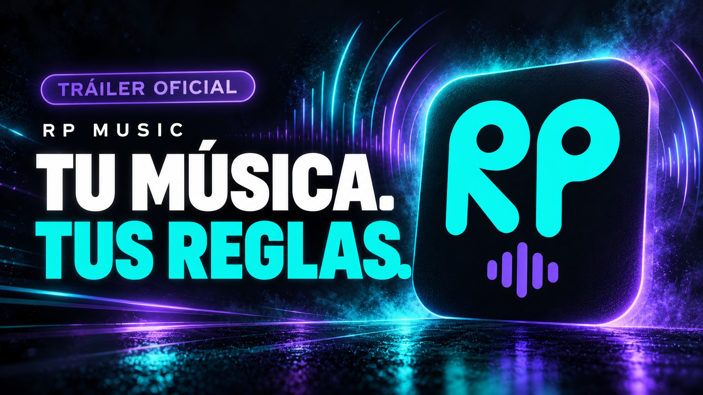

# RP Music

Reproductor local para Android y Windows. Abre tu biblioteca y escucha música sin cuenta ni conexión.

[Descargas para Android universal, ARM64 y Windows](https://github.com/Joao-s02/rp_music/releases/latest) · [Documentación](docs/README.md)

## RP Music 0.5.2 Beta

En Android puedes compartir el archivo de una canción local desde **Reproductor → ⋮ → Compartir canción**.

## RP Music 0.5.1 en desarrollo

Al terminar, la cola conserva sus ediciones y ofrece reiniciarla. Repetir todo empieza otra vuelta automáticamente.

El ecualizador incorpora diez bandas, una curva arrastrable, filtros paramétricos y perfiles JSON. Android añade preamplificación, balance estéreo y limitador. Estos tres controles en Windows requieren una compilación de libmpv con los filtros FFmpeg correspondientes.

## RP Music 0.5.0 Beta

El ecualizador del reproductor incorpora un modo Básico con preajustes y un modo Avanzado para editar las bandas y ver la curva de ganancias.

Temas se abre desde Ajustes → Apariencia en Android y Windows.

[Uso](docs/USO-0.5.0.md) · [Cambios](docs/CAMBIOS-0.5.0.md) · [Pruebas](docs/PRUEBAS-0.5.0.md)

## RP Music 0.4.9

Primera candidata de publicación con el código propio bajo GPL-3.0-or-later. Windows x64 integra libmpv de Immuch360 con sus avisos y su código fuente correspondiente. Android incluye el inventario y los avisos de sus dependencias.

[Cambios](docs/CAMBIOS-0.4.9.md) · [Pruebas](docs/PRUEBAS-0.4.9.md)

## RP Music 0.4.8

Portadas de álbum más grandes en Android, un solo menú por álbum y minirreproductor renovado con atajos de teclado en Windows.

[Cambios](docs/CAMBIOS-0.4.8.md) · [Uso](docs/USO-0.4.8.md) · [Pruebas](docs/PRUEBAS-0.4.8.md)

## RP Music 0.4.7

Selector compacto de Biblioteca, menús unificados y cabeceras adaptables para listas y álbumes.

[Cambios](docs/CAMBIOS-0.4.7.md) · [Uso](docs/USO-0.4.7.md) · [Pruebas](docs/PRUEBAS-0.4.7.md)

## Corrección 0.4.6

Corrige la apertura del reproductor en Android anteriores a 14, restaura el logo de Biblioteca en móvil y alinea los encabezados de las pestañas.

[Uso](docs/USO-0.4.6.md) · [Cambios](docs/CAMBIOS-0.4.6.md) · [Pruebas](docs/PRUEBAS-0.4.6.md)

## RP Music 0.4.5

Menú del reproductor con ecualizador y temporizador, gestos de cola y detalles, cabeceras compactas y menú contextual de listas. La biblioteca comprueba cambios al arrancar y reutiliza miniaturas guardadas.

[Uso](docs/USO-0.4.5.md) · [Cambios](docs/CAMBIOS-0.4.5.md) · [Pruebas](docs/PRUEBAS-0.4.5.md)

## RP Music 0.4.3

Menús de canción renovados, fotos de artistas en Ajustes y fundido configurable entre canciones.

[Uso](docs/USO-0.4.3.md) · [Cambios](docs/CAMBIOS-0.4.3.md) · [Pruebas](docs/PRUEBAS-0.4.3.md)

## RP Music 0.4.4

RP Music 0.4.4 incorpora ecualizador, reproducción sin pausas y ReplayGain en Ajustes de reproducción. Biblioteca, Favoritos y Listas concentran los controles de vista y orden en sus cabeceras.

[Uso](docs/USO-0.4.4.md) · [Cambios](docs/CAMBIOS-0.4.4.md) · [Pruebas](docs/PRUEBAS-0.4.4.md)

## Cola editable desde 0.4.2

La cola editable muestra el orden real de reproducción, incluso en aleatorio. Añade canciones o colecciones a continuación o al final. Mantén pulsada una canción en Android o haz clic derecho en Windows para abrir sus acciones. Desde la cola puedes arrastrar, quitar y deshacer cambios sin interrumpir la canción actual.

[Uso de la cola](docs/USO-0.4.2.md) · [Cambios](docs/CAMBIOS-0.4.2.md) · [Pruebas](docs/PRUEBAS-0.4.2.md)

## Novedades de 0.4.1

Se corrigen la transición del reproductor con fondos personalizados, la reutilización de carátulas y el resaltado al desplazar. Miku revisión 2 amplía iconos y centra los controles. Listas agrupa filtros/acciones; Temas ofrece secciones desplegables y revisiones compatibles; Letras comparte movimiento en ambos modos y muestra carátula junto al título.

Las fotos son opcionales y se activan en Artistas. Al cargar una foto se consultan el nombre y una canción en Deezer, con Wikimedia de respaldo por nombre. No se envían archivos ni audio. Se conserva la procedencia y la caché privada; una coincidencia ausente o dudosa muestra el icono de respaldo. [Datos enviados y uso](docs/USO-0.4.1.md#fotos-de-artistas-y-conexión).

## Novedades de 0.4.0

RP Music se centra en la escucha de tu biblioteca local. Temas sustituye Explorar en la navegación y permite importar o descargar colores, fondos e iconos para toda la app. [Catálogo, guía y plantilla de temas](https://github.com/Joao-s02/rp-music-themes).

Se retiran las extensiones, incluidas YouTube, Radio y la búsqueda de letras por internet. Se conservan las letras incrustadas y los LRC/TXT importados. La actualización limpia las letras privadas con marca de origen en línea y convierte las listas automáticas en listas locales editables.

Biblioteca por carpetas, álbumes y artistas, búsqueda, favoritos, listas y portadas. Cola, aleatorio, repetición y restauración sin iniciar audio. Letras sincronizadas según las marcas del archivo, controles multimedia y widgets Android.

## Instalación y actualización

En Android, instala el APK apropiado sobre la app existente para conservar tus datos. En Windows, extrae el ZIP completo, incluidas DLL y licencias. [Guía de uso](docs/USO-0.4.1.md).

## Verificación

138 pruebas automatizadas aprobadas y análisis limpio. Android universal/ARM64 firmados y Windows x64 compilado y empaquetado con sus dependencias. Instalación, fluidez, Play Protect y escucha prolongada finales pendientes de validación física. [Pruebas y límites](docs/PRUEBAS-0.4.1.md).

## Desarrollar y colaborar

```sh
flutter pub get
flutter run -d windows
# Android: consultar flutter devices y usar el ID disponible
flutter run -d ID_DEL_DISPOSITIVO
```

[Compilación](docs/COMPILACION.md). No ejecutar tests/builds Flutter concurrentes ni distribuir sondas de integración. Herramientas verificadas durante este desarrollo: Flutter 3.47.6/Dart 3.13.5; comprobar entorno antes de compilar.

Consulta [AGENTS.md](AGENTS.md) y el [índice de documentación](docs/README.md).

## Licencia

El código propio de RP Music se ofrece bajo la [Licencia Pública General de GNU](LICENSE), versión 3 o, a tu elección, cualquier versión posterior (`GPL-3.0-or-later`).

Las dependencias y los recursos de terceros conservan sus respectivas licencias. Consulta los [avisos de terceros](THIRD_PARTY_NOTICES.md), la [política de marca](BRANDING.md) y la [guía para distribuir el código fuente](docs/DISTRIBUCION-FUENTE.md).

## Tráiler

[](https://youtu.be/lobwRKtXv-M)

▶ **[Ver el tráiler de RP Music en YouTube](https://youtu.be/lobwRKtXv-M)**
