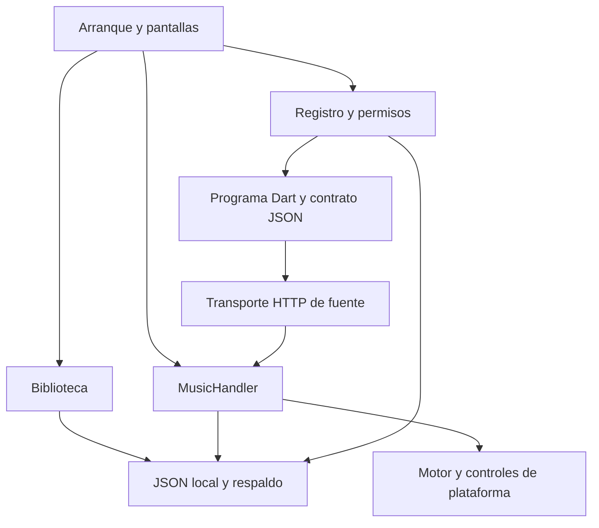

# Arquitectura vigente

Corrección local0.3.10+19: factory createNativeAudioPlayer selecciona media_kit/libmpv solo en Windows; sustituye WinRT para M4A/OPUS y fuentes. Android/audio_service preservados. MusicHandler observa errores/cargas, diagnóstico redactado, cancelación y límite de carga Windows. Selección provisional y evidencia en [[39 Audio Windows M4A OPUS y YouTube]]; referencia publicada0.3.9 siguiente es antecedente hasta nueva publicación.

Ampliación publicada 0.3.9+18: JavascriptScreenService coordina HTTP fuera de QuickJS; ProgramController valida etapas/estado y conserva URLs solo en memoria. ExtensionSourceService/broker admite pantallas JS autorizadas sin cambiar propietario source. network.stream verifica servidores públicos de emisoras. Cancelación y revisión de autorización descartan respuestas tardías. Pruebas/límites: [[37 Explorador y radio JavaScript]]. El mapa publicado 0.3.8 siguiente se conserva como antecedente.

## Alcance y criterio

Mapa de la implementación observada en el código de 0.3.8, no propuesta de reconstrucción ni elección irreversible de paquetes. Estado de distribución/verificación en [[10 Estado del repositorio]]. El alfa y arquitectura-reproductor-flutter.md son antecedentes; [[11 Reconstruccion - primera base]] explica el inicio de esta implementación.

## Componentes y responsabilidades

| Componente | Responsabilidad | Código |
| --- | --- | --- |
| Arranque | Configura almacenamiento, audio/sesión, notificaciones, actualizador y programas; conecta plataforma y restaura sesión sin autoplay. | [main.dart](../lib/main.dart) |
| Biblioteca | Estado observable con ChangeNotifier: raíz, catálogo/caché, favoritos/listas, preferencias y operaciones de archivo. | [LibraryController](../lib/app/library_controller.dart) |
| Interfaz | Pantallas Material, tema, navegación adaptable, álbum, reproductor expandido y carátulas/listas. | [MusicApp](../lib/app/music_app.dart), [tema](../lib/app/music_theme.dart), [álbum](../lib/app/album_detail_view.dart), [reproductor](../lib/app/expanded_player.dart) |
| Modelos | Track, artistas derivados por coma, formato conocido y orden, sin edición de etiquetas del archivo. | [Track](../lib/domain/track.dart), [orden](../lib/domain/track_sort.dart) |
| Archivos | Selección/escaneo/metadatos/borrado; Android delega a canal nativo y Windows usa rutas/lector Dart en trabajo separado. | [MusicFiles](../lib/data/music_files.dart), [scanner](../lib/data/library_scanner.dart), [scanner Android](../android/app/src/main/kotlin/com/example/rp_music/LibraryScanner.kt) |
| Persistencia | JSON en soporte de app, escrituras serializadas, temporal/archivo anterior y recuperación desde respaldo. | [LocalStore](../lib/data/local_store.dart) |
| Audio | MusicHandler: cola, comandos, estado multimedia, carga/errores/generaciones, historial y sesión. just_audio/audio_session y AudioService en Android. | [MusicHandler](../lib/playback/music_handler.dart), [configuración](../lib/playback/playback_config.dart) |
| Programas | Registro/permisos/propietarios/recuperación, compilación y ejecución Dart aisladas de UI, contratos JSON. | [controlador](../lib/extensions/program_controller.dart), [runtime](../lib/extensions/program_runtime.dart), [paquete](../lib/extensions/program_package.dart) |
| Coordinación | Snapshots autorizados, reglas de listas automáticas y política avanzada de siguiente pista. | [coordinador](../lib/extensions/program_coordinator.dart), [snapshot](../lib/extensions/program_snapshot.dart) |
| Fuentes | Flujo de programa/HTTP genérico, validación de resultados y resolución; broker conecta el audio al reproductor. | [servicio](../lib/sources/extension_source_service.dart), [HTTP](../lib/extensions/extension_http_transport.dart), [broker](../lib/sources/extension_source_broker.dart) |
| Plataforma | Widget/notificación Android, cierre/bandeja Windows y diagnóstico multimedia. | [plataforma](../lib/platform/desktop_lifecycle.dart), [widget Android](../android/app/src/main/kotlin/com/example/rp_music/MusicWidget.kt) |
| Actualizador | Consulta GitHub, versiones/canales, descarga/hash y consentimiento de instalación; ZIP manual en Windows. | [actualizador](../lib/updates/update_controller.dart) |

El programa no dibuja Flutter arbitrario: el anfitrión interpreta su salida y presenta componentes permitidos. Los contratos visuales son más limitados que la visión final.

## Flujo local

Al abrir se carga catálogo guardado; no se lanza un escaneo nuevo automático. Elegir raíz/Actualizar inicia descubrimiento y lectura progresivos con caché. El controlador mantiene una copia estable hasta terminar: error conserva la anterior. El escaneo no reescribe archivos; eliminar audio es otra operación confirmada, con escritura SAF cuando hace falta.

Seleccionar una canción forma la cola y carga el motor. Una generación identifica la selección vigente para descartar resultados tardíos. Tras cargas correctas se mantiene historial de anterior/avance; restaurar filtra IDs contra biblioteca disponible y no inicia reproducción. Ver [[03 Biblioteca y reproduccion]].

## Persistencia

| Ubicación relativa al soporte de app | Datos |
| --- | --- |
| v2/library.json | Raíz/catálogo, favoritos/listas/metadatos de listas, preferencias y API 1. El campo schema de esta biblioteca es 1; v2 es nombre de carpeta, no ese campo. |
| v2/session.json | IDs de cola, pista/posición, aleatorio/repetición e historial anterior/avance. Restauración local, no biblioteca online completa. |
| v2/updates.json | Preferencias/estado del actualizador. |
| v2/playlist_covers | Imágenes propias normalizadas de listas; mosaico toma carátulas disponibles. |
| v3/extensions.json | Paquetes API 2, permisos, habilitación, propietarios, datos privados autorizados y marcador de recuperación. |

LocalStore conserva archivos backup y usa pending durante escritura. Las carpetas no deben borrarse al actualizar. No se migraron datos de la antigua alfa 0.1. Metadatos remotos se recuerdan en memoria; URLs firmadas no se usan como identidad ni se guardan como sesión. Guardar IDs de una cola no implica restaurar una fuente que no está en la biblioteca local.

## Audio y plataformas

Dependencias actuales en [pubspec](../pubspec.yaml): just_audio, audio_session, audio_service y backend Windows just_audio_windows_plus 0.5.5. audio_service 0.18.19 se resuelve a copia local mediante dependency_overrides; [parche](../third_party/audio_service/RP-MUSIC-PATCH.md) documenta dos ajustes Android. No sustituirla por Pub sin revisar y validar comportamiento.

Android usa servicio multimedia y canales nativos de biblioteca/sistema. Windows usa su backend y canal de ciclo de vida para bandeja/salida. No inferir de esto DSP, DAC, SMTC completo o cualquier códec comprobado. Evidencia específica de cada entrega en las notas de pruebas.

## Programas y fuentes

ProgramController comprueba habilitación/permisos y propietario de función. Registra llamada en curso para recuperación y desactiva tras fallos repetidos. ProgramRuntime permite imports restringidos, compila/ejecuta en isolates y limita fuente a 64 KiB, compilación a 12 s, ejecución a 2 s, entrada a 4 MiB y salida a 512 KiB; caché de ocho programas. Esos límites no son aislamiento de proceso ni cuota dura de RAM.

El SDK de biblioteca usa IDs opacos y metadatos autorizados; conserva artist y añade artists. Las reglas se ejecutan por programa y las listas automáticas se conservan inactivas al desactivar su extensión.

Para source, el programa devuelve solicitudes y etapas; el anfitrión aplica HTTPS/dominios, GET/POST, sin redirecciones, cuerpos/respuestas/plazos acotados y máximo cuatro rondas. Resolución y resultado se validan antes/después de llamadas; revocar/cambiar propietario detiene esa fuente y descarta respuestas tardías. El broker entrega audio al MusicHandler, con nombre de fuente y carátula. La lógica específica de proveedor vive solo en su repositorio. Contrato detallado: [API 2](../docs/EXTENSIONES-API-2.md).

navigation.add y sourceConfig aportan etiqueta/icono/color mediante componentes nativos del anfitrión. Se muestra el destino de la fuente elegida compatible con la plataforma. No es acceso para alterar código compilado.

## Distribución, deuda y siguientes cambios

App, versión de paquete y apiVersion son números distintos. pubspec.yaml y app_version.dart deben mantenerse juntos; paquetes declaran minAppVersion, y el catálogo elige variante compatible fijando revisión Git y verificando bytes. El hash no prueba autoría.

Separación y deuda heredada: [[04 Extensiones]]. Políticas de release: [[27 Publicacion de releases - contenido obligatorio]]. Benchmarks/aislamiento/funciones aún no implementadas: [[07 Preguntas e investigacion]]. Este trabajo documental no cambia módulos, permisos, binarios ni el esquema de datos.

## Evolución 0.3.4

[[32 Pruebas 0.3.3 y mejoras 0.3.4]]: Lyrics interpreta LRC; LyricsView presenta posición real y guarda copia privada por ID. El núcleo no contiene clientes LRCLIB/Spotify/YouTube; source/lyrics usa el transporte de extensiones existente. SourceDownload exporta audio resuelto con storage.download y selector. Navegación lista todas las fuentes autorizadas/plataforma, conservando propietario único y elección explícita. No se cambia el esquema de biblioteca/sesión.

## Evolución 0.3.5

[[33 Metadatos de descargas YouTube]]: LyricsController sigue selección de MusicHandler y coordina EmbeddedLyrics/MusicFiles, caché privada y proveedor elegido en capacidad lyrics. Lectura de documentos SAF con copia privada temporal acotada en Android; rutas directas/isolate en Windows. Letras locales recuperadas no se escriben en la música. DownloadEnrichment consume source/metadata y DownloadTags añade etiquetas genéricas MP4 sin recodificar. Proveedores de búsqueda/metadatos permanecen en el checkout independiente rp-music-extensions. No se modifica el esquema de biblioteca/sesión; nuevas copias de letras y su huella se guardan en soporte privado. Contratos y límites nuevos en API 2 y nota temática. La validación local no equivale a publicación ni a prueba física Android.

## Corrección 0.3.6 — contenedor fragmentado

DownloadTags separa MP4 plano y fragmentado: el diseño de moov final de 0.3.5 es incompatible con fragmentos que requieren inicialización previa. La ruta corregida mantiene moov delante de sidx/moof y admite solo offsets relativos validados; otras variantes vuelven al audio original con aviso. Herramienta genérica de reparación a copia nueva, sin sobrescribir originales ni contener lógica del proveedor. Evidencia del archivo real y pruebas sintéticas en [[34 Descarga M4A no visible en biblioteca]]. Publicado como 0.3.6-alpha.1; prueba física todavía pendiente.

Trabajo local 0.3.7+16: variante YouTube Explorador 0.1.0 con ID independiente, sin alterar YouTube Android 0.4.0 ni catálogo. Navegación pública e importación persistente implementadas localmente; cuenta/sincronización pendientes. Contratos y evidencia en [[35 Ampliacion de YouTube sin API oficial]]. No publicado.

Prototipo local 0.3.8+17: API 3/JavaScript en paralelo a Dart; pantallas por árbol genérico, estado/eventos y reproducción explícita autorizada. Laboratorio JS separado en repositorio de extensiones. Paquetes YouTube sin modificar. No publicado; verificación y límites en [[36 Motor JavaScript paralelo]].

0.3.10 publicada: motor Windows libmpv, M4A/OPUS y audio YouTube API2/JS comprobados, variantes Windows y Radio0.1.1 en catálogo externo. Evidencia, licencias y límites vigentes en [[39 Audio Windows M4A OPUS y YouTube]]. Android físico/latencia API3 pendientes.

Desarrollo0.3.11: gesto de pistas, widgets adaptables, encabezados de listas/álbum remoto, descarga secuencial con contexto de álbum y retratos privados offline. Track incorpora albumArtist/numeración y versión de lectura2: primera actualización relee caché antigua sin modificar originales. Capacidades genéricas en app; fuentes/selección de metadatos/paquetes en repositorio externo. Evidencia/estado exacto en [[40 Gestos widgets albumes y descargas 0.3.11]].

0.3.11 publicada: gestos, widgets adaptables, colecciones, descarga por álbum y retratos offline; identidad albumArtist/numeración/metadataVersion2 y contrato sourceConfig.artistArtwork/library.read. Verificación y límites actuales en [[40 Gestos widgets albumes y descargas 0.3.11]]. No modifica música existente.

Trabajo local0.3.12+21: letras sincronizadas prioritarias, escena visual con tiempos reales, reproductor fijo/volumen emergente y cola centrada/animada. Fuente/paquetes/pruebas específicas exclusivamente en repositorio de extensiones; catálogo publicado intacto. Contexto, verificaciones y pendientes en [[41 Letras dinamicas y reproductor fijo 0.3.12]]. Referencia pública0.3.11 conservada.

## Cierre 0.3.12 publicado

Letras sincronizadas, vista Escena, reproductor fijo y cola centrada publicados. Resultados, revisión externa y límites vigentes: [[41 Letras dinamicas y reproductor fijo 0.3.12]].

## Desarrollo local 0.3.13

Informe confirmado de letras 0.3.12 y corrección de álbum/identidad visual/consentimiento conjunto: [[42 Albumes y extensiones con identidad RP 0.3.13]]. No publicada.

## Cierre 0.3.13 publicado

Corrección de álbum y datos parciales, interfaz de álbumes/fuentes/extensiones, cola más lenta y consentimiento conjunto publicados. Evidencia y límites vigentes: [[42 Albumes y extensiones con identidad RP 0.3.13]].

## Transición de firma local0.3.14

Actualizador admite certificado descendiente mediante linaje Android, manteniendo comprobaciones de identidad/versión/hash y validación de sistema. Primera transición desde0.3.13 se abre desde Archivos. Firma moderna/compatibilidad antigua, pruebas y límites en [[43 Play Protect y firma de Android]]. No publicada.

Perfil local 0.3.15 sin instalador: capacidad nativa derivada de permisos reales del manifiesto; controlador y vista ofrecen actualización mediante página oficial cuando falta REQUEST_INSTALL_PACKAGES. No altera motor musical ni extensiones. Experimento y evidencia en [[44 Diagnostico local de instalacion y actualizaciones manuales]].

Tras resultado seguro de Play Protect frente a bloqueo del control, el perfil manual pasa a ser predeterminado de release. Instalación/identidad/lista conservadas comprobadas en emulador; pendiente teléfono, sin publicar.

## Cierre 0.3.15 publicado

Actualización Android por web/Archivos sin permiso para instalar paquetes y firma compatible publicados. Usuario confirma instalación sin aviso en su teléfono; alcance y evidencia: [[44 Diagnostico local de instalacion y actualizaciones manuales]].
